# Instituto de Ensino


Sistema web de gestão acadêmica para uma instituição de ensino, com **áreas separadas para aluno, professor e administrador**. Feito em **Java (Servlets + JSP)** com padrão **DAO**, pool de conexões e banco **H2**.

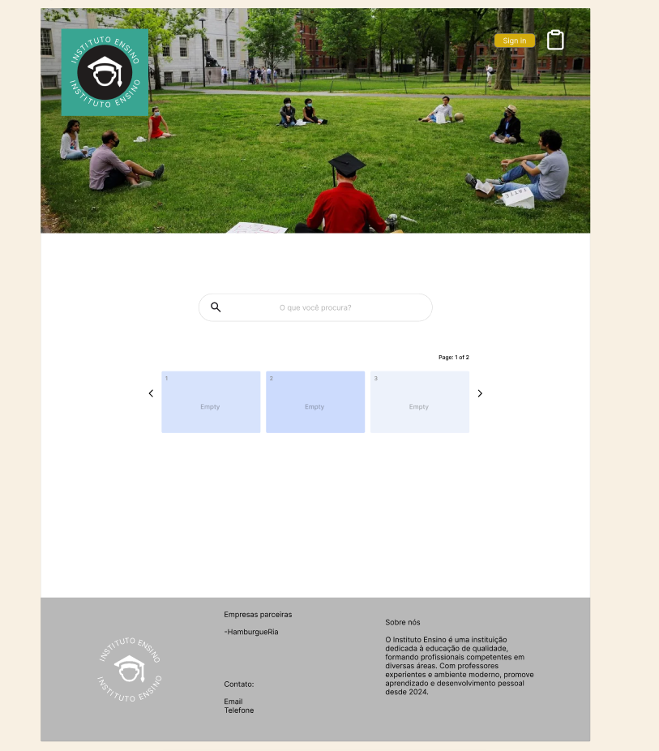

## Funcionalidades

- **Página inicial:** carrossel de cursos com busca e popup de detalhes (modalidade, duração, campus, turno e matérias)
- **Cadastro e login:** autenticação de alunos, professores e administradores
- **Área do professor:** tabelas de alunos por matéria, lançamento de notas e faltas, e posts para a turma
- **Área do aluno:** mural com os posts dos professores e boletim de notas e faltas por matéria
- **Painel administrativo:** CRUD de cursos, matérias, usuários, alunos e professores, com dashboard de todas as tabelas

## Arquitetura

```text
src/main/java/br/com/institutoensino/
├── model/      # Curso, Materia, Usuario, Aluno, Professor, AlunoMateria, PostProfessor
├── dao/        # Acesso a dados (JDBC) por entidade
├── servlet/    # 30+ servlets: CRUD, login/logout, posts, notas
├── filter/     # Controle de acesso: AdminFilter, ProfessorFilter, AlunoFilter
├── listener/   # Cria o usuário administrador na inicialização
└── config/     # Pool de conexões (DBCP2) e criação do schema
src/main/webapp/  # Páginas JSP + CSS
```

- **Controle de acesso por perfil** com *Servlet Filters*
- **Pool de conexões** com Apache Commons DBCP2
- **Schema criado automaticamente** a partir de `script.sql` na subida da aplicação

## Como executar

Requer **JDK 11+** e **Maven**.

```bash
cd app/institutoensino
mvn tomcat7:run
```

Acesse `http://localhost:8080`. O banco H2 fica em `~/test` e um usuário administrador padrão é criado na primeira execução (veja `AdminInitializerListener`).

## Modelagem

| DER | MER |
|:--:|:--:|
| 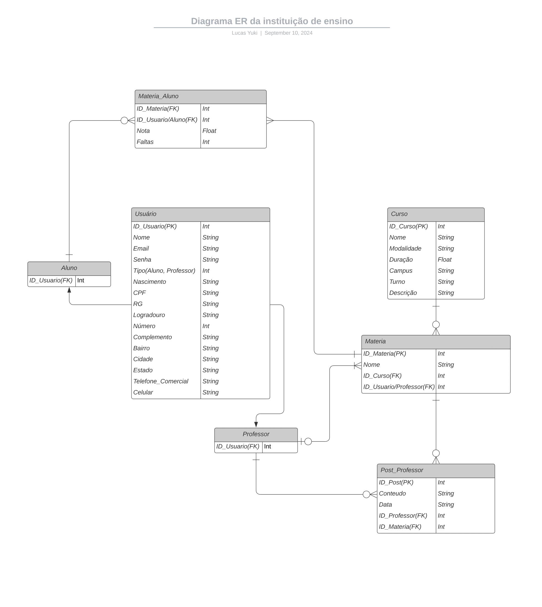 | 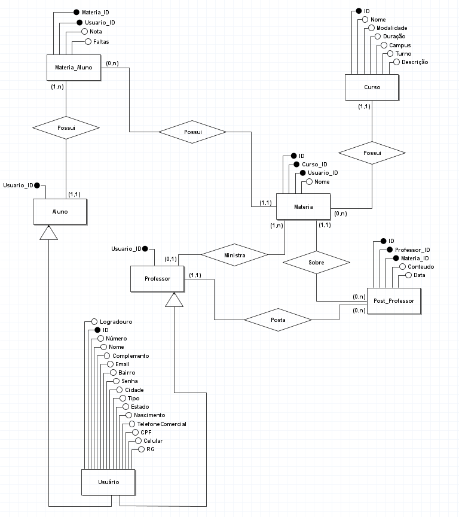 |

## Telas

| Login | Cadastro |
|:--:|:--:|
| 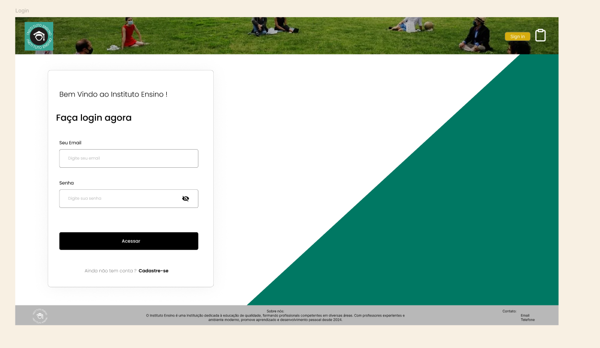 | 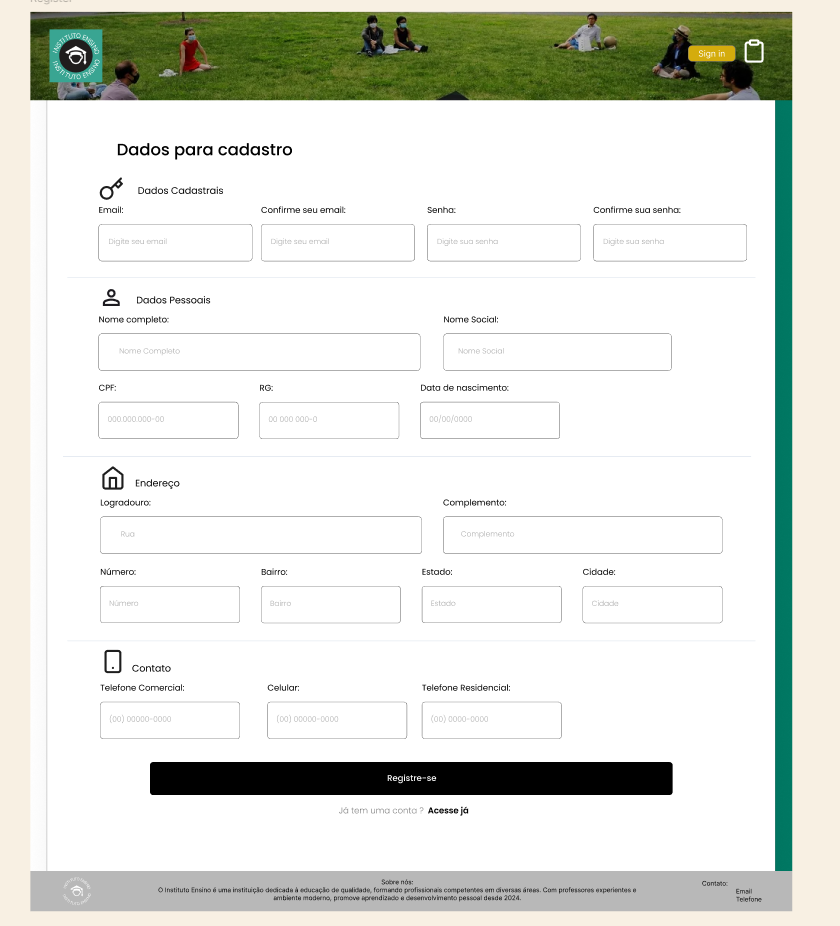 |
| **Professor** | **Aluno** |
| 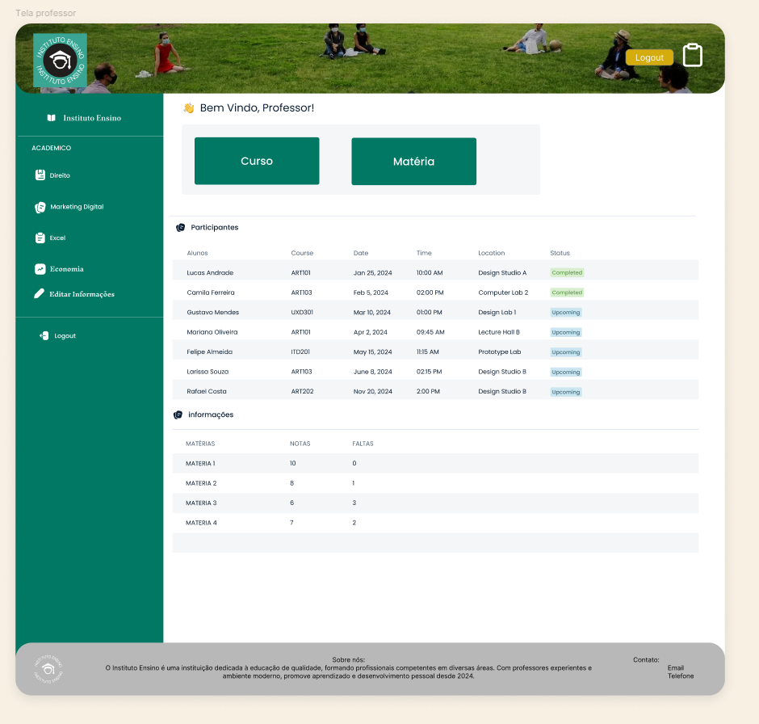 | 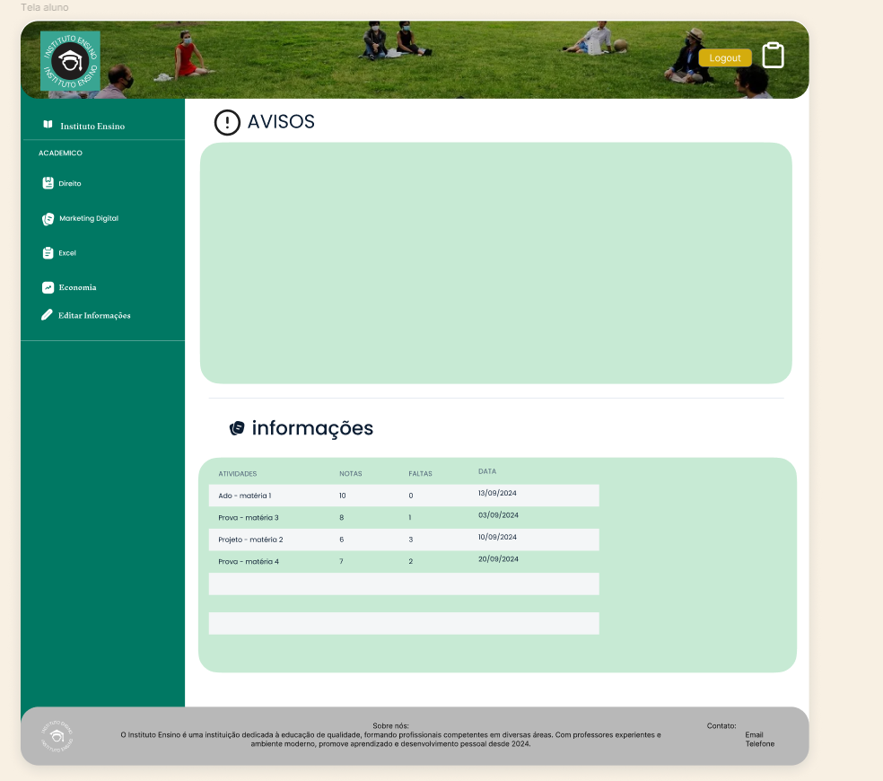 |

<details>
<summary>Detalhes dos cursos</summary>

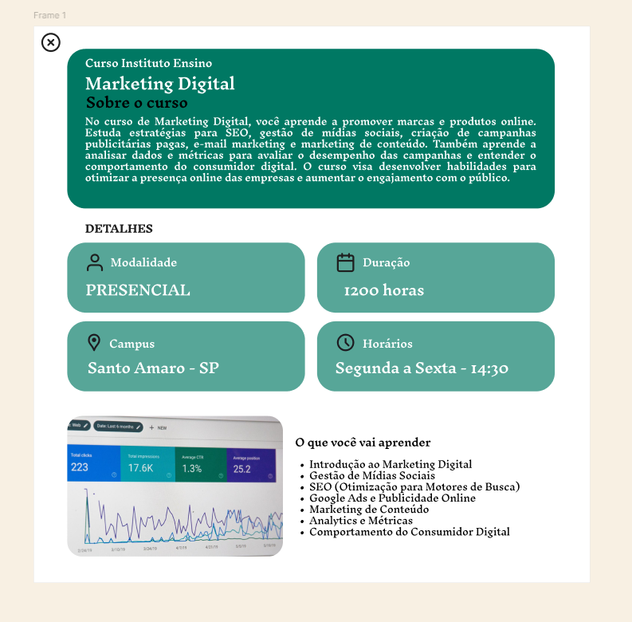
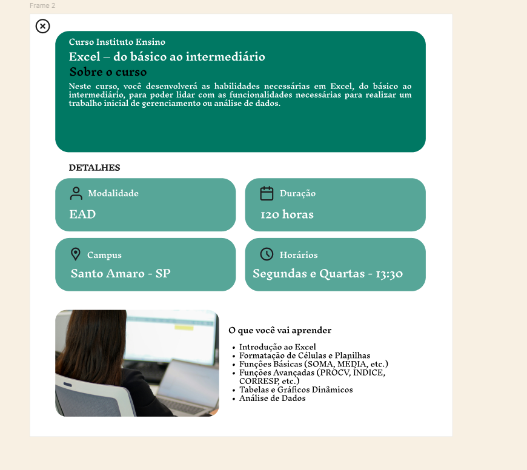
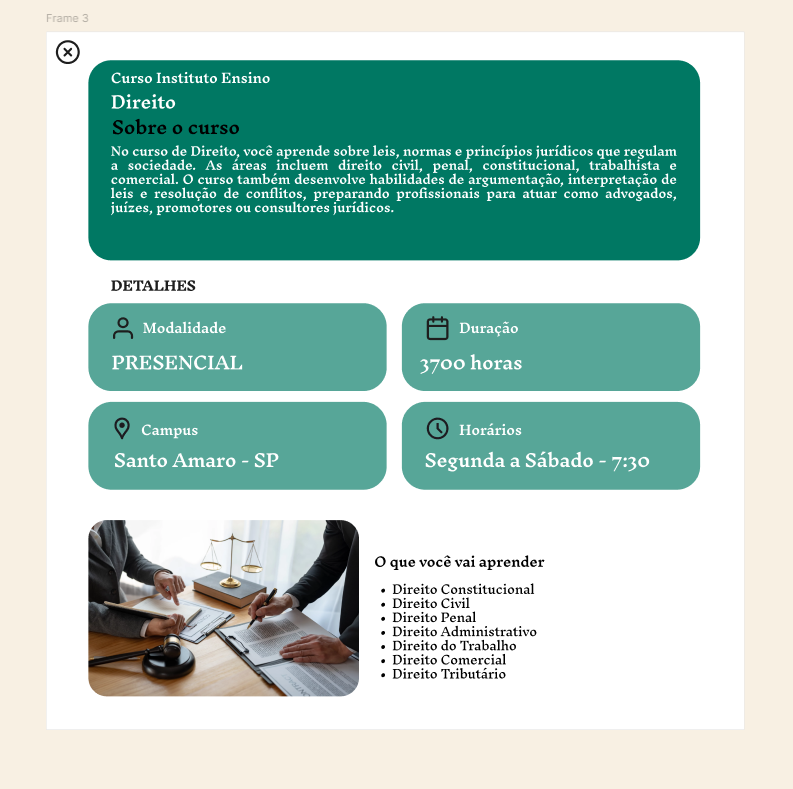
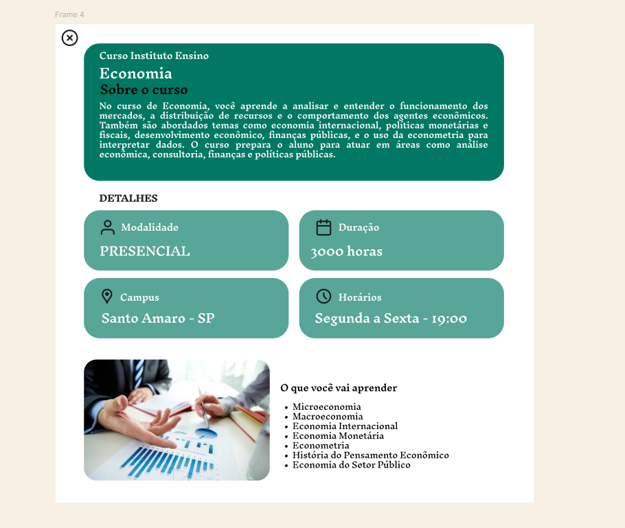

</details>

## Contexto

Projeto acadêmico desenvolvido em dupla no curso de Análise e Desenvolvimento de Sistemas (SENAC São Paulo), em 2024 :)
